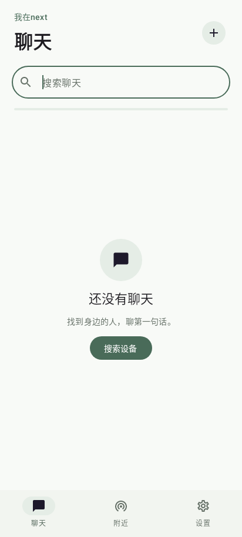
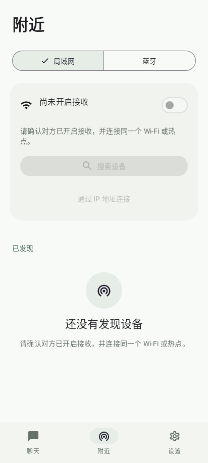
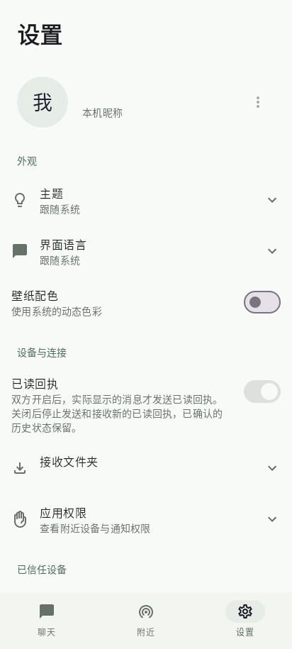

# 我在next · Android 实验客户端

`app-next` 使用 Kotlin、Jetpack Compose 和 Material 3，应用名称为 **我在next**，包名为 `dev.ghost.nearbyim.next`。可以与原「我在」独立安装。设备身份、密钥、信任、聊天记录和草稿分别保存在各自的 Android 沙箱中，不自动导入旧端数据。

以下为 Robolectric API 34 绘制的 Compose 界面。通信服务处于不可用测试状态，因此部分控件禁用；不是真机或模拟器截图。[截图来源与校验值](screenshots/android-next/manifest.json)。

<p>
  
  
  
</p>

## 实现范围

| 页面 | 本轮实验实现 |
| --- | --- |
| 会话 | 本地历史、昵称/摘要搜索、真实连接状态、身份头像 |
| 附近 | LAN / 经典蓝牙、接收开关、搜索/停止、地址直连、记住设备、首次来访认可 |
| 聊天 | 文字、草稿、多文件/照片选择和发送前预览、附件进度与路径、接收/拒绝/暂停/续传/重发、打开/另存为、送达/已读状态 |
| 身份 | 完整安全码手动核对、二次确认、持久身份核验；不以昵称或发现条目认定身份 |
| 设置 | 昵称、头像编辑、五种语言、深浅色/跟随系统、可选壁纸动态色、已读开关、接收文件夹、设备信任管理、系统权限入口 |
| 布局 | 手机底部导航、宽窗口导航栏与会话/聊天分栏、系统字号、边到边和键盘避让 |

本轮没有迁移旧端的自定义 Emoji 面板、二维码扫描/图片核验入口、聊天清空入口、附件批量重发/队列控制、速度与剩余时间详情、保存位置诊断和应用内字号偏好；表情可使用系统输入法。照片查看、附件顺序预览和头像裁剪继续复用原生辅助 Activity。尚未实现完整折叠屏铰链避让或可拖拽分栏。

## 通信复用方式

`app-next:sharedJava` 是一个 Gradle Sync 任务，每次构建从原 `app/src/main/java` 和 `third_party/noise-java/src` 生成字节一致的编译输入，排除旧 `MainActivity.java`。Kotlin 的 Java 源码发现不遵守 Java SourceDirectorySet 的排除规则，因此两种编译器使用同一份过滤后的构建目录。该目录不提交，不维护第二份内核。

`ChatService`、`ChatController`、协议、Noise、LAN、蓝牙、自动文件选路、存储和签名身份实现均复用原源码。Compose 主 Activity 只负责生命周期、系统权限、选择器与 UI 状态。通知仍由原 ChatService 发出，点击后进入 Compose 主界面。

没有启动默认监听或自动发现。文件选择结果绑定设备、会话令牌和会话身份，返回时等待服务重新绑定，过期结果被拒绝。草稿只在消息已持久保存且内容仍匹配时清除；已读沿用内核 `ReadVisibility` 的驻留规则，只采集实际可见的入站文字正文，并检查前台、焦点和解锁状态。

## 本地构建与验证

需要 JDK 17、Android SDK Platform 36 和 Build Tools 35.0.0：

```sh
./gradlew :app-next:testDebugUnitTest :app-next:assembleDebug :app-next:lintDebug
```

版本名和 buildNumber 从 `i18n/config.json` 读取，不单独改写发布版本。JVM 测试覆盖选择器会话绑定、发送完成/草稿加载竞态、较新输入保留和 UTF-8/未完成代理字符限制。Robolectric API 34 测试验证 Compose 导航、未命名蓝牙设备及大字号横屏语言选择；它们属于 JVM 环境，不能证明真实 Android 服务绑定、无线互通或真机图形效果。

CI 工作流为 `.github/workflows/android-next.yml`。调试 APK 仅供内部验证；安装交付仍受 `AGENTS.md` 的持久证书规则约束。目前既有签名脚本面向原 applicationId，正式分发 next 前还需给该脚本增加独立包名的严格校验，不能用 debug 签名代替持久签名。

## 设备验收边界

仍需真机验证 LAN/蓝牙互通、首次信任与安全码、蓝牙权限拒绝/开启取消、文件选择与重连/旋转/进程恢复、10 GiB 附件与自动选路、后台前台切换，以及滚动/弹窗/锁屏时的已读抑制。系统文件提供者和不同厂商权限界面也需设备验证。本轮不宣称完成这些验收。
