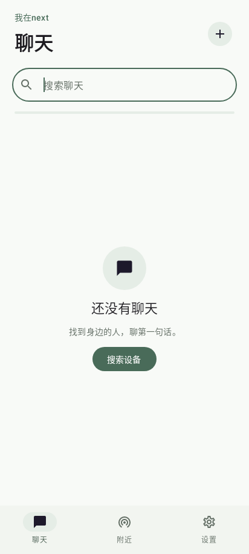
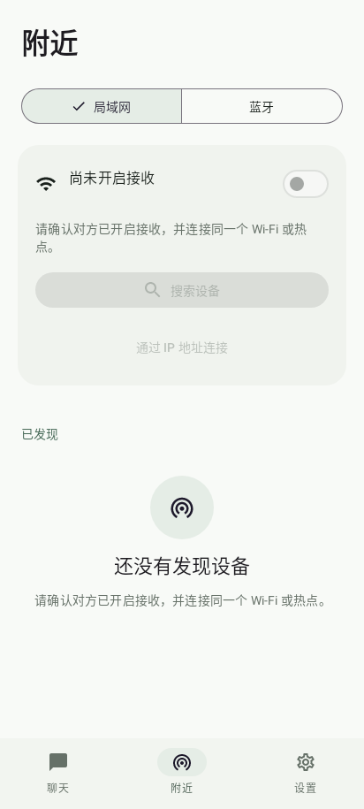
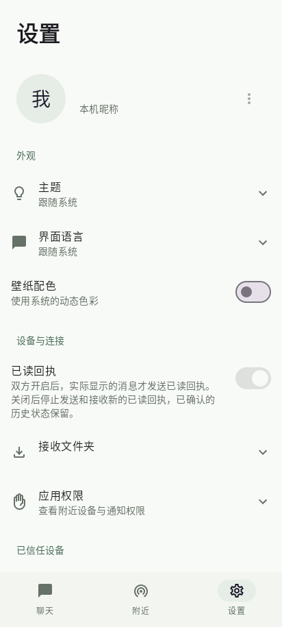

# 我在next · Android 实验客户端

`app-next` 使用 Kotlin、Jetpack Compose 和 Material 3，应用名称为 **我在next**，包名为 `dev.ghost.nearbyim.next`。可以与原「我在」独立安装。设备身份、密钥、信任、聊天记录和草稿分别保存在各自的 Android 沙箱中，不自动导入旧端数据。

以下为**初版历史截图，不代表 #94/#95 修改后的当前界面**，来自 Robolectric API 34 绘制的 Compose 界面。通信服务处于不可用测试状态，因此部分控件禁用；不是真机或模拟器截图。[截图来源与校验值](screenshots/android-next/manifest.json)。

<p>
  
  
  
</p>

## 实现范围

| 页面 | 本轮实验实现 |
| --- | --- |
| 会话 | 本地历史、昵称/摘要搜索、身份头像；文字区分断开/连接、认可、E2EE 与身份核验 |
| 附近 | LAN / 经典蓝牙、接收开关、搜索/停止、地址直连、记住设备、首次来访认可 |
| 聊天 | 全量 Unicode Emoji 面板（搜索/分类/最近/变体、光标插入）、文字、草稿、多文件/照片选择和发送前预览、附件字节/进度/速度/剩余时间/续传检查与路径、接收/拒绝/暂停/续传/重发、打开/另存为、送达/已读状态 |
| 身份 | 完整安全码手动核对、二次确认、二维码展示/扫描/图片核验/PNG 另存；结果绑定身份根与连接代次，持久核验仍由原控制器校验 |
| 设置 | 昵称、头像编辑、五种语言、深浅色/跟随系统、可选壁纸动态色、已读开关、接收文件夹、设备信任管理、系统权限入口 |
| 布局 | 手机底部导航、宽窗口导航栏与会话/聊天分栏、系统字号、边到边和键盘避让 |

本轮仍未迁移聊天清空入口、附件批量重发/队列控制、完整 #79 传输详情页/保存位置诊断和应用内字号偏好。Emoji、二维码和基础速度/剩余时间信息已通过现有内核能力恢复。照片查看、附件顺序预览和头像裁剪继续复用原生辅助 Activity。尚未实现完整折叠屏铰链避让或可拖拽分栏。

## 通信复用方式

`app-next:sharedJava` 是一个 Gradle Sync 任务，每次构建从原 `app/src/main/java` 和 `third_party/noise-java/src` 生成字节一致的编译输入，排除旧 `MainActivity.java`。Kotlin 的 Java 源码发现不遵守 Java SourceDirectorySet 的排除规则，因此两种编译器使用同一份过滤后的构建目录。该目录不提交，不维护第二份内核。

`ChatService`、`ChatController`、协议、Noise、LAN、蓝牙、自动文件选路、存储和签名身份实现均复用原源码。Compose 主 Activity 只负责生命周期、系统权限、选择器与 UI 状态。通知仍由原 ChatService 发出，点击后进入 Compose 主界面。

没有启动默认监听或自动发现。文件选择结果绑定设备、会话令牌和会话身份，返回时等待服务重新绑定，过期结果被拒绝。草稿只在消息已持久保存且内容仍匹配时清除；已读沿用内核 `ReadVisibility` 的驻留规则，只采集实际可见的入站文字正文，并检查前台、焦点和解锁状态。

## 本地构建与验证

需要 JDK 17、Android SDK Platform 36 和 Build Tools 35.0.0：

```sh
./gradlew :app-next:testDebugUnitTest :app-next:assembleDebug :app-next:lintDebug
```

版本名和 buildNumber 从 `i18n/config.json` 读取，不单独改写发布版本。服务常规观察通知（包括传输测量）最多每 250 ms 合并刷新一次，不额外轮询；会话/连接变化、保存开始/完成、草稿编辑与操作回调保持即时，避免延迟清除已发送草稿。传输测量作为显式状态传给卡片，避免不可变消息未变化时跳过速度刷新。速度缺失时明确显示等待测量，检查阶段使用真实 checkedBytes，未知进度使用不定进度条。

JVM 测试覆盖光标选区插入、检查进度、可见会话/草稿/控制器一致性、全量 Emoji 搜索/最近/变体、短气泡宽度与测量变化呈现，以及选择器会话绑定、发送完成/草稿加载竞态、较新输入保留和 UTF-8/未完成代理字符限制。Robolectric API 34 测试验证 Compose 导航、未命名蓝牙设备及大字号横屏语言选择；它们属于 JVM 环境，不能证明真实 Android 服务绑定、无线互通或真机图形效果。

CI 工作流为 `.github/workflows/android-next.yml`。调试 APK 仅供内部验证；安装交付仍受 `AGENTS.md` 的持久证书规则约束。安装交付通过 `android-next.yml` 的 `signed=true` 手动构建：`tools/build-signed-next.py` 在临时目录内使用仓库持久密钥，`tools/verify-android-signature.py --next` 严格核对固定证书、独立包名、版本、非 debug 属性与源码修订。不能用 debug 签名代替持久签名。

## 设备验收边界

仍需真机验证 LAN/蓝牙互通、首次信任与安全码、蓝牙权限拒绝/开启取消、文件选择与重连/旋转/进程恢复、10 GiB 附件与自动选路、后台前台切换，以及滚动/弹窗/锁屏时的已读抑制。系统文件提供者和不同厂商权限界面也需设备验证。本轮不宣称完成这些验收。


## #95 功能对等审计 / parity audit

| 项目 | 分类 | 旧版 | Next 当前实现 / 边界 |
| --- | --- | --- | --- |
| IME 输入栏错位 | 已确认布局故障 #94 | 视图布局 | 单一 Scaffold 安全区/IME 消费；合成 phone/tablet/短窗口回归通过，真机 pending |
| Emoji 面板 | 已确认缺失功能 | Unicode 16 / CLDR 47 全量目录 | 复用同一目录；五语言搜索、九分类、最近 30 个、变体选择、替换光标选区；保持原草稿保存规则 |
| 速度、剩余时间、检查字节 | 已确认缺失功能 | TransferProgress | 同源测量；已传/总字节、百分比、速度/ETA、未知测量、检查进度；常规测量 UI 观察最多 4 Hz，关键会话/保存转换即时 |
| 暂停/续传/重试/完成后文件操作 | 已有能力 / 设备待验 | 内核操作 | 保留原控制器入口，不改变文件语义；提供者/断线/大文件实测 pending |
| 二维码核验 | 已确认缺失功能 | 展示/扫描/图片/导出 | 复用 QrCodes、QrScanActivity、PhotoDecoder；待返回请求保存 peer/双方根/generation，等待服务重绑后校验；图片限 1024 边长，解码在后台 |
| 传输诊断复制 / #79 对齐 | 已有入口恢复，详细页仍待迁移 | 控制器诊断文本复制 | 安全/设备信息页提供当前连接的诊断复制；检查当前 peer/双方根/generation，保持原 schema/隐私语义；不是逐文件归因，不伪造全局平均值，完整 #79 详情页 pending |
| 认可、E2EE、身份已核验 | 设计与可发现性 | 文字和安全页 | 会话状态使用文字标签，不把认可/E2EE 当作身份核验；手动核验保持二次确认 |
| 短消息留白、列表密度 | 设计反馈，非预先认定 Bug | 依内容布局 | 文字气泡自然宽度，最大 min(520dp, 可用宽度 88%)；压缩标题/搜索间距；仍需真实截图评估 |
| 未读数 | 共享模型未提供 | 不推断有持久未读计数 | Conversation 仅有摘要/方向/回执/时间，无未读计数；不伪造角标，不把发送回执当未读 |
| 原生视觉、响应式与无障碍 | 设计改进 | 原生 View | Compose Material 3 中性色、可选系统动态色；新控件最少 48dp，系统字号及既有宽窗分栏；完整设备/对比度验收 pending |
| 清空聊天、批量队列、完整诊断详情页、应用内字号 | 其余功能差异 | 存在入口 | 本轮未迁移，不列为已完成 |
| Mesh、折叠铰链/可拖分栏 | 范围外 / 未实现 | 不作为本轮对等承诺 | 不修改协议/内核/存储/i18n 权威，不实现 Mesh |

## #95 真机验收清单（全部 pending）

当前没有连接的物理 Android 设备；自动化输出不是设备验收或真实前后截图。记录设备型号、系统/API、窗口 dp、字体倍率、导航方式、连接方式及当前源码修订后，逐项执行并附真实前后截图/录像：

| 场景 | 操作与预期 | 状态 |
| --- | --- | --- |
| 手机/平板气泡 | 短文本、长文本、多行、Emoji/ZWJ、代码/长 URL、附件；左右对齐、自然宽度且无裁剪 | pending |
| Emoji 与草稿 | 五种语言搜索、每分类、最近、肤色/性别变体；在中间光标/反向选区插入；切会话、旋转、加载/保存竞态、失败发送后内容保留 | pending |
| 传输状态 | LAN/蓝牙发送接收、排队/准备/检查/暂停/续传/失败/完成；对照内核真实字节/速度/ETA；无测量明确提示；观察耗电/滚动 | pending |
| 安全二维码 | 两台设备展示/扫描/图片/另存、手动二次确认；错误码不认可；扫描/选择器/解码时断线重连、切会话及旋转，旧代次结果不写核验 | pending |
| 会话状态 | 发现≠连接≠认可≠已核验；仅 E2EE 不显示已核验；重连和撤销信任后状态正确；无虚构未读数 | pending |
| 视觉/无障碍 | 浅/深色、动态色开关、字体 1.0/1.3/1.8/2.0、TalkBack、48dp 触控、手势/三键导航；核查文字/图标对比度 | pending |
| 窗口与 IME | 手机/平板横竖屏、分屏、短窗口；附件/Emoji/安全弹窗与键盘交替、反复旋转；沿用 [#94 矩阵](android-next-ime-acceptance.md) | pending |

不以 Robolectric 绘图替代以上证据；不勾选 GitHub Issue 的真机验收项。


## #94 / #95 修复包（2026-11-01）

[下载持久签名安装包](https://github.com/GHOST-AKU/wozai/actions/runs/41318359303/artifacts/13088103487)（GitHub 下载需要登录），取其中 `WoZai-next-0.3.3-preview.4-android.apk`。此包仍为 preview.4 / build15，修复源码为 `7b8827d84c4ffa764140b975afa336d3ca8f0c28`；不要仅凭版本名判断是否为本次修复。使用原持久证书，可覆盖同证书的现有 Next，保留其独立数据。

[CI 测试/调试编译/lint 通过](https://github.com/GHOST-AKU/wozai/actions/runs/41318363510)；[release 编译、lint 与持久签名核对通过](https://github.com/GHOST-AKU/wozai/actions/runs/41318359303)。本地最终 22 项测试通过，debug lint 0 错误、55 警告；158 个共享 Java 编译输入逐字节一致。#94 单独提交 `7219727`，#95 随后提交 `51214d6`，独立审查通过。后续仅证据文档变更复用以上构建，不重复打包。

APK SHA-256：`20e4ac297460c1659e7ef9b30f8abca8d8f12048246950cb1fbc112ca393dfd9`。证书 SHA-256：`47a10fd5a882ab26c9a11fcc61df3b41f7c41017746fc6840cfbe581ca52c1dd`。CI 使用 `tools/verify-android-signature.py --next` 核对证书 pin、包名、版本、非 debug 属性与源码；本地另核对了 CI 的签名报告字段，不声称重新执行过本地 APK 验签。

这不是手机或平板的真机通过声明。#94 的 IME 动画/焦点/系统导航和 #95 的视觉、互通、选择器、长时传输验收仍按上面的矩阵 pending，issue 保持开放。
