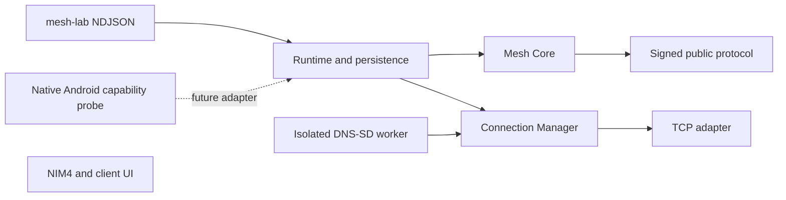

# ADR-001：独立 Rust Mesh Core 与有界公共消息实验

状态：采纳为实验架构，**不是冻结的正式线协议或生产安全认证**。日期：2026-10-31。关联 [#60](https://github.com/GHOST-AKU/wozai/issues/60)。该 Issue 的客户端 UI/发行和无线硬件验收没有因此完成。

## 问题与范围

NearbyIM 已有 NIM4、Noise 和各平台生命周期。Mesh 的研发需要独立验证路由及无线拓扑，避免给正式客户端引入未经证明的广播、自动信任或重发语义。本轮仅发送签名的公共 UTF-8 文本，建立一个可独立构建的 `mesh/` crate 和 headless `mesh-lab`。公共内容中继可读；没有端到端加密或全局送达承诺。

仓库调查：根 Gradle 当前只 include `:app`，Rust terminal 是独立 Cargo 项目；Android `TransportListener` 要求主线程回调，Wi-Fi Direct 的自动连接策略还专门绑定已批准的私聊文件尝试。直接复用这些具体运行时会耦合 UI/私聊授权。因此只借鉴 stream 边界与既有独立 Cargo 组织，不把它们改作公共邻居入口。

## 候选方案与选择依据

| 方案 | 正确性与开发复杂度 | 部署、体积、FFI、内存/性能及维护 |
| --- | --- | --- |
| Rust 核心 + 原生平台传输（选择） | 所有平台共享验证/路由状态机；成熟密码库；平台边界要单独设计、测试 | 核心内存安全、无 GC；可编译 CLI；Android JNI/Apple C ABI 或 UniFFI 有绑定和生命周期成本，本轮未实现 FFI。实际 Linux release 体积/RSS 见测量报告，不能据此推导各平台包大小 |
| Kotlin/Java Android 先行 | 最快调用 Android radio API、直接测试权限/后台；共享已有工程经验 | JVM 原型足够做设备研究，但 Windows/Apple 需要移植或嵌入运行时；不假设 Java 比 Rust 慢，也未对另一实现跑基准。本轮原生探针用 Java，路由不绑定 Android |
| rust-libp2p + Gossipsub | 成熟签名/连接/主题 gossip，MIT 可合法集成；但不附带手机 BLE/Aware、可靠 DTN、签名逻辑跳数边界 | 更大的依赖和协议/策略面；体积与内存必须在具体选项构建后比较，目前没有测量就不报数字。后续需要主题/大网覆盖时重新评估 |
| Meshrabiya / Briar / Reticulum/LXMF | 各自已有虚拟网络、关系组同步或 DTN；适合参考 | Android 依赖、不同消息语义或许可条件带来集成成本；当前 Reticulum/LXMF 为有用途限制的自定义许可。全部不直接搬用实现 |
| Python/Go 原型 | Python 便于实验编排，Go 便于自包含网络服务 | Python 不是本轮移动可嵌入核心选择；Go c-shared/移动绑定及 GC 也需评估。没有对它们实测性能，不作绝对性能结论 |

Rust 的理由是本轮跨平台核心边界、可测试性及仓库已有独立 Rust 交付模式；Android 原生探针验证 radio API，Python 只编排测试。不引入 GUI 框架。选型是研发判断，不宣称已经证明各平台最低体积/最佳耗电。

## 模块与依赖方向

- `protocol.rs`：规范签名字节、完整 ID、期限、逐跳签名链验证，不做 I/O。
- `core.rs`：受控泛洪、去重、跳数、准入限流、待发队列、有限邻居/重试与期限。当前是确定性小网泛洪；不实现自创最短路算法，也不声称规模可扩展到任意节点数。
- `transport.rs`：4-byte length + JSON 的 TCP 帧、非阻塞流控与握手状态。BLE 等必须实现自己成熟 API 的连接、分片/重组及流控，不能直接塞 32 KiB GATT write。
- `manager.rs`：最多 16 个不可信地址候选、至多 4 个 500ms 超时的拨号任务、指数退避+jitter；认证完成后按公钥折叠重复连接；地址变化通过新候选进入。
- `store.rs`：独立身份、独占锁、原子写入/同步的有界去重索引，无正文持久化；损坏时拒绝启动，不能假装“清缓存恢复”。
- `discovery.rs`：可选 LAN DNS-SD，默认关闭，独立 Linux 子进程、96 MiB 地址空间硬限额，60s 窗口/最早 65s 重启。第三方动态缓存不能悄悄扩大核心资源面；worker 失败不会给未知设备授予信任。
- `android-probe/`：独立 Instrumentation、无 Activity，限时观察 Wi-Fi P2P/Aware/BLE 的能力和真实回调；不是 Rust 数据路径适配器。

## 协议与安全决策

详情见 [协议规范](protocol.md)。使用 Ed25519-dalek 严格验证和 SHA-256，不自行实现密码学。不可变正文绑定版本/类型、完整来源键、随机 nonce、创建/截止时间、最大 1–8 跳与 1–2048 UTF-8 字节正文；默认 3 跳、600s。完整摘要为 ID。

逐跳 receipt 绑定前缀摘要和下一个接收身份，链尾绑定经 challenge/response 证明持有私钥的 TCP 邻居；删改前缀或把旧链尾当作另一个邻居拒绝。链长就是消耗的逻辑传输预算，无可重置的 unsigned TTL。仍无法阻止起源重新发布、串通隧道、Sybil 或物理邻接造假；协议与原语还需独立安全审计。

握手只证明一个公共假名的密钥持有。发现陌生节点 → 建立公共邻接 → NIM4 已信任私聊设备 → 用户授权中继服务是四种不同权限。此实现没有 NIM4 导入/信任接口。中继默认关，只有 `--relay` 或本地 `relay(enabled=true)` 明确启用；连接未知公共节点不替代任何 NIM4 确认。

## 有界资源与状态语义

默认上限：8 条已接纳 TCP link（含握手），另有最多 4 个待完成拨号；16 个候选；32 KiB/frame；8 个 TX frame/link；64 条待发消息；1024 个有效去重 ID；每消息最多 8 个出口邻居、每邻居最多 3 次 offer。重连可能再发，接收端持久去重防止重复展示。

每 link 每秒 32 frame/128 KiB 入口预算，单轮至多处理 8 frame；全局每自然分钟 128 条新消息、每来源 16 条、最多 64 个来源 bucket。自然分钟边界允许相邻窗口短时双倍 burst，不宣称滑动窗口。握手 3s，静默 15s，心跳 3s。无效消息不能写去重。有效索引满时拒收，不能驱逐仍有效 ID。TX 满则暂停从核心取出，连接失败释放本次 offer，有限次数重试。

状态 `pending` → `handed_to_neighbor_unconfirmed` 仅表示本地 socket 写完；没有端到端 ACK。到期为 `expired_unconfirmed`，拒收有明确错误，非正常重启报告 `failed_restart` 数量。正文/待发队列不落盘，所以不能提供可靠 DTN、历史同步或跨进程重启后的续传；对重复收到但本地已丢队列的消息不会重新展示或假装完成转发。用户正常退出也没有可靠交付保证。

时钟最多允许来源在未来 30s，期限到达即拒绝，无到期宽限；运行时 high-water 防本进程时钟回退复活旧消息，持久化 saved-at 用于拒绝明显回退后的启动。没有网络可信时间，手机时钟大幅不一致可能导致拒收；不通过延长消息期限解决。

诊断命令只输出计数/限额，不能输出正文、私钥或稳定公钥。正常 lab 交互日志会输出公共正文、完整签名路径和公开键，便于本地实验；它不是安全导出文件，分享时只导出 `diagnostics` 或已脱敏证据。身份种子文件是本地明文 0600，不是平台密钥库/硬件防提取实现；后续需要 Android Keystore/Apple Keychain/FFI signer 接口。

## 平台运行与下一阶段边界

生命周期/电量/隐私控制在适配器外层：撤销 relay consent、低电量或后台策略可暂停中继、停止扫描并关闭链接。第一轮没有后台服务、自动系统权限弹窗或电池测量，不承诺常驻。Android/Apple 限制、两种可行替代拓扑及验收见 [移动研究](mobile-transports.md) 和 [硬件计划](hardware-validation.md)。

真实设备 gates 通过后再设计可靠存储、相遇同步、加密公共主题或可靠虚拟字节流。NIM4-over-Mesh、多路径、端到端私聊和 Noise 会话重发均需独立 RFC/安全分析。Mesh 不构成 NIM5 升级理由。正式客户端、NIM4、Noise、身份及现有传输在本分支保持不变。
