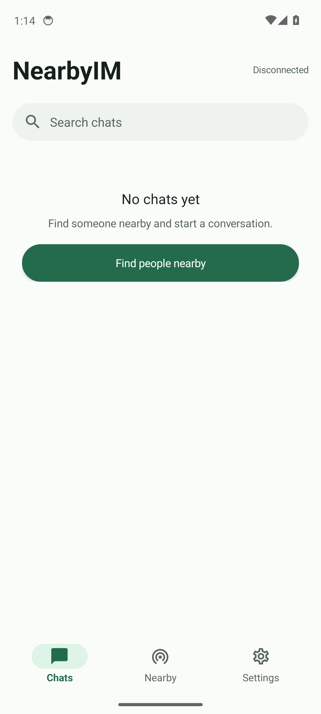
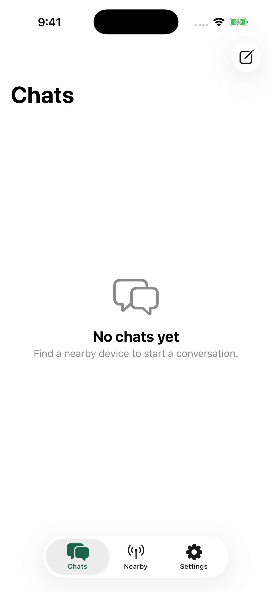

# 我在 · NearbyIM

[简体中文](../../README.md) | [English](README.en.md) | **日本語** | [한국어](README.ko.md)

**遠隔の中継設備を通さず、近くの相手と会話を。**

我在（NearbyIM）は、近くの端末同士で会話するための、ソースコードを公開した通信アプリです。正式版は Android、Windows、Linux に対応し、**LAN** と **従来型 Bluetooth（Classic Bluetooth）** で接続できます。試用版では **macOS・iPhone・iPad 向けの専用実装**と、**Windows/Linux 向けの端末用実装（TUI/CLI）**も提供しており、現在は主に LAN 経由で相互に通信します。利用者登録や、外部の会話中継設備は必要ありません。

> 最新の正式版：**0.3.3** · Android / Windows / Linux
> [正式版を入手](https://github.com/GHOST-AKU/wozai/releases/tag/v0.3.3) · [課題一覧](https://github.com/GHOST-AKU/wozai/issues)
>
> 過去の試用版：**0.3.3-preview.1** · macOS / iPhone / iPad / Windows・Linux Terminal
> [試用版を入手](https://github.com/GHOST-AKU/wozai/releases/tag/v0.3.3-preview.1) · [導入と署名の説明](../releases/native-preview-install.md)

**正式配布 `v0.3.3` は、作成済みの `0.3.3-preview.4` / build15 を再コンパイルせず配布します。** アプリ内・ファイル名・パッケージ管理上の版番号は preview のままです。署名・ソース・SHA-256 は変更していません。[0.3.3 を入手](https://github.com/GHOST-AKU/wozai/releases/tag/v0.3.3) · [更新内容](../releases/0.3.3.md)。Apple と Terminal は引き続き試用段階の機能・署名制限があります。

**0.3.2 の基本機能：** Android・Windows・Linux の通信仕様と操作画面を更新し、Linux 向けには AppImage / deb / tar.gz を提供しています。Noise による端末間暗号化、使用資源を制限した最大 10 GiB の分割転送と再起動後の転送再開、添付資料の通信経路自動選択、Android の受信先指定、大画面・折り畳み端末への基本対応を追加しました。変更点と検証範囲は [0.3.2 の更新内容](../releases/0.3.2.md)を参照してください。P2P の安定性、実機での速度や距離による切断からの復帰、長時間利用時のメモリ使用量、正式な性能評価は [#23](https://github.com/GHOST-AKU/wozai/issues/23) と [#9](https://github.com/GHOST-AKU/wozai/issues/9) で継続して確認しています。

## 0.3.3 の変更内容

文字の既読通知は標準で有効で、いつでも無効にできます。双方が有効にし、文章が前面の会話に実際に表示された場合のみ通知します。既読表示は `#66CCFF`、暗いテーマのみ控えめに発光します。Terminal は既読通知に未対応です。絵文字選択、下書き保存、デスクトップの言語切替、Linux AppImage の互換性も改善しました。入力欄の常時バイト数表示は削除しました。

既存の preview.4/build15 の配布物を再コンパイルせず、正式 Release v0.3.3 として公開しました。携帯電話の画面は縦向きのみ掲載します。シミュレータの画像は実機の無線通信・性能検証を意味しません。

## 実行画面と入手先

<p align="center">
  
  
</p>

[各環境の実行画面と入手先](../screenshots/0.3.3-preview.4/README.md)。Android・iPhone は縦向きのみ。Apple の署名制限、ソースとハッシュも記載しています。配布物は正式 Release から入手でき、Actions のリンクはビルドの出所を示します。

## 🌱 「我在」を作る理由

多くの会話用アプリは、外部への通信回線、利用者登録、中継設備があることを前提にしています。

「我在」が目指すのは、別の方法です。**二人がすぐ近くにいるなら、端末同士で直接話せてもよいのではないでしょうか。**

現在は、仕組みを理解しやすい近距離通信に力を注いでいます。端末が互いを見つけ、相手を信頼するかどうかは使う人が決める。文章や添付資料は、端末から端末へ直接送ります。二人は、すぐ近くにいるのですから。

(｡•̀ᴗ-)✧

## 🏡 こんな場面で使えます

- **自分の端末同士で資料を渡す**：携帯端末から手元のPCや大画面端末へ、文章・写真・文書を送れます。外部への事前送信も、同じ製造元の端末をそろえることも不要です。同じ LAN または端末の無線 LAN 共有に接続して始められます。
- **職場・教室・制作現場でやり取りする**：同じ LAN にいる同僚や友人と一対一で話し、文書や素材を交換できます。通信網が端末間の接続を許可していれば、有線接続のPCも参加できます。
- **外部回線のない仮設会場で使う**：展示会や催し、屋外の共同作業で、既設の通信設備や手動で有効にした無線 LAN 共有を利用できます。外部回線への接続は不要です。従来型 Bluetooth 対応版では、Bluetooth による文字通信も試せます。
- **登録せず、近くの人と連絡する**：付近の端末を見つけ、双方が接続や端末識別情報の保存を判断します。会話履歴と受信した資料は、それぞれの端末に保存されます。
- **端末画面や自動処理から使う**：Windows/Linux の端末画面で会話や資料の送受信ができます。CLI の JSON 出力と終了状態を使えば、自動処理にも組み込めます。SSH 経由で操作する場合、探索や接続に使うのは接続先のPCが属する通信網です。

現在の対象は、**直接到達できる端末同士の一対一通信**です。外部回線を介した中継、複数人での会話、Mesh・多段中継は提供していません。動作保証のある緊急通信手段の代わりにはなりません。OS ごとに接続方式と機能が異なり、Apple 向けと Terminal は試用版です。詳しくは下の対応状況を参照してください。

## ✨ 現在の機能

以下は主に Android / Windows / Linux の正式版についての説明です。Apple 向けと Terminal の試用版については、対応状況を確認してください。

- **LAN で直接接続**：NSD / mDNS による自動探索と、IP・接続番号を指定する直接接続
- **従来型 Bluetooth 通信**：保護された RFCOMM による探索、接続先の登録、再接続
- **異なる OS 間で会話**：Android・Windows・Linux で共通の暗号化通信仕様 NIM4 を使用
- **文章・画像・添付資料**：会話内の画像表示、最大 10 GiB の資源使用量を制限した分割転送、複数選択と順次転送、一時停止・再開・失敗時の再試行
- **転送経路の自動選択**：端末の既存の無線 LAN 共有を再利用し、一時的な P2P、LAN、接続済み Bluetooth を試行。品質に応じて LAN を選択し、切断後は保存済みの位置から再開。会話画面に実際の経路を表示
- **受信先の指定**：Android では標準の資料管理機能から参照できる保存先を選択。Windows/Linux では元の名前で開く操作と、名前を付けて保存する操作に対応
- **信頼した端末との再接続**：初回の承認時に長期識別情報を保存し、次回以降も同じ端末か確認
- **保存後の到達確認**：相手側が内容を保存してから受領を通知
- **端末内の履歴と下書き**：外部との同期に依存せず、各端末に保存
- **五言語対応**、明暗の配色と文字の大きさの設定
- **利用者登録不要・利用状況の自動収集なし・外部の会話中継設備なし**

## 💻 OS ごとの対応状況

| 対象 | LAN | 従来型 Bluetooth | 文章 | 画像・添付資料 | 状態 |
| --- | --- | --- | --- | --- | --- |
| Android | ✓ | ✓ | ✓ | ✓ | 主な携帯端末向け実装 |
| Windows GUI | ✓ | ✓ | ✓ | ✓ | 正式版 |
| Linux GUI | ✓ | ✓ | ✓ | ✓ | 正式版 |
| macOS / iPhone / iPad | ✓ | — | ✓ | ✓ | OS 標準部品による試用版。Android と完全には同等でない |
| Terminal（Windows / Linux x64） | ✓ | — | ✓ | ✓ | TUI/CLI 試用版 |

Windows/Linux 版には実行環境を同梱しているため、Java を別途導入する必要はありません。使い方と検証範囲は [Windows の説明](../windows.md)と [Linux の説明](../linux.md)を参照してください。

iOS・iPadOS・macOS 向けには、Apple の標準部品を使った **Swift / SwiftUI による試用版**を提供しています。NIM4 による LAN 内の暗号化文字通信、資料・画像の転送、端末の承認、端末内履歴、QR による識別情報の照合に対応しています。Mac 向け配布物は Intel と Apple Silicon に対応し、iPhone/iPad は共通の実機用 IPA を使用します。Apple 向けの利用者画像、Bluetooth/P2P/添付資料専用経路などは、まだ完全には実装されていません。実機・性能検証は [Apple 向けの説明](../apple.md)と [#31](https://github.com/GHOST-AKU/wozai/issues/31) を参照してください。

**Apple 向け試用版には、正式配布用の署名がありません。** Mac 向けは ad-hoc の一時署名のみで、Developer ID による署名と公証はありません。iPhone/iPad 向け IPA は未署名のため、そのまま選択して導入することはできず、利用者自身による署名と導入が必要です。最低対応版は macOS 14、iOS/iPadOS 17 です。無料の利用者登録で署名を更新する手順も含め、[導入の説明](../releases/native-preview-install.md)を確認してください。

## ⌨️ NearbyIM Terminal（試用版）

**NearbyIM Terminal** は、Rust で独立して実装した端末用の TUI/CLI です。主な実行命令は `nearbyim`（Windows では `nearbyim.exe`）で、全画面の TUI と CLI の両方を使えます。実行時に JRE・GUI・Android SDK は不要です。[Windows/Linux x64 向け試用版](https://github.com/GHOST-AKU/wozai/releases/tag/v0.3.3)を入手・展開し、`nearbyim` を実行してください。命令一覧は `nearbyim --help` で確認できます。

- NIM4 の端末承認と安全確認番号、LAN 探索・直接接続、文章、履歴・下書き、資料の分割転送・順次処理・一時停止・再開・保存後の受領通知に対応。利用者画像の同期と QR による照合も行えます。
- **初期状態では LAN の接続待受を行いません。** 未知の端末や資料の受信を自動承認することもありません。TUI の初回起動時に設定を案内します。CLI は JSON 出力と終了状態を提供します。詳しくは [Terminal の使い方（英語）](../../terminal/README.md)を参照してください。
- 公開済みの `0.3.3-preview.1` に含まれる Terminal の内部版番号は `0.1.0-dev` です。今後の新規ビルドは共通の `0.3.3-preview.4` を使います。Windows 向けには Authenticode 署名がありません。今回の試用版に macOS 向け Terminal 実行形式は含まれません。
- Bluetooth/P2P などへの対応と全体の検証は開発中です。端末画面、IME、SSH/tmux、実機間通信、性能の検証範囲は [#38](https://github.com/GHOST-AKU/wozai/issues/38) で扱います。既存 GUI 版の置き換えではなく、正式版 0.3.2 の配布物も変更しません。

## 📡 会話を始める

以下は Android / Windows / Linux の GUI 正式版の操作です。Apple 向けの導入と接続は[試用版の説明](../releases/native-preview-install.md)、Terminal は[端末用実装の説明（英語）](../../terminal/README.md)を参照してください。画面上の項目名は、実際の日本語表示に合わせています。

### LAN

1. 両方の端末を同じ Wi-Fi に接続するか、一方の端末で無線 LAN 共有を有効にします。
2. 双方で NearbyIM を開き、**「近く」→「LAN」→「LAN の受信を開始」**を選びます。
3. 一方から相手の端末を探し、会話を始めます。
4. 初回の接続時は、受信側が相手の端末を信頼するか判断します。
5. 次回からは、会話履歴から再接続を試せます。

自動探索で見つからない場合は、相手側の**「自分の接続アドレス」**に表示される IP と接続番号を使って直接接続できます。来客用 Wi-Fi、学内通信網、VPN、端末間通信の制限などによって、互いに接続できない場合があります。

### Bluetooth

1. 双方で Bluetooth を有効にし、NearbyIM の**「近く」→「Bluetooth」→「Bluetooth の受信を開始」**を選びます。
2. 接続される側で、一時的に端末の検出を許可します。
3. もう一方から相手を探して会話を始めます。初回は OS の案内に従って端末同士の接続登録を行います。
4. 初回の承認後は端末の識別情報を記憶し、会話履歴から再接続できます。

## 🔐 安全性と個人情報

0.3.2 は **Noise XX / X25519 / OS 提供の AES-256-GCM / SHA-256** により、端末間の文章と添付資料を保護します。既存の P-256 長期端末識別鍵による署名は、双方の識別情報、Noise 公開鍵、接続確立時の通信記録、対応機能を結び付けます。既存の端末 UUID と信頼情報は維持します。接続ごとに新たな暗号化通信を確立し、認証・完全性・版の検証に失敗した場合は接続を閉じます。

注意点：

- **公開済みの 0.3.1 では、LAN 上の内容は平文です。** NIM3 の認証と署名はありますが、端末間暗号化ではありません。Bluetooth には別途 OS の RFCOMM 通信保護があります。
- 表示名は、実在する人物の本人確認を意味しません。初回承認（TOFU）は端末公開鍵を受け入れる操作です。対面など、信頼できる方法で相手の識別情報を照合してください。
- 会話履歴と添付資料は、暗号化されていない状態で端末内に保存されます。通信の暗号化は、保存領域の暗号化を意味しません。OS による自動バックアップは無効にしています。
- 会話履歴を消去しても、端末への信頼は自動解除されません。端末情報や設定から別途解除できます。

標準試験値、異なる実装間の通信、異常入力に対する試験を備えていますが、正式な暗号安全性監査と Bluetooth 実機検証は完了していません。

## 🧩 NIM の通信仕様と版

NIM は、NearbyIM が端末間で文章と添付資料を交換する際の、アプリケーション層の通信仕様を識別する名称です。電文形式、認証、受領通知、資料転送の規則を定めています。LAN、Bluetooth、Wi-Fi Direct は通信経路であり、別々の NIM の版ではありません。通信仕様の版とアプリの版番号も異なります。

| 仕様 | 使用時期 | 主な機能と安全性の範囲 |
| --- | --- | --- |
| NIM1 | 初期の試作版 | 基本的な電文分割。後の版で追加された端末識別署名と端末間暗号化は未実装 |
| NIM2 | 0.2.0 以降の初期版 | P-256 による端末識別、接続時の応答認証、電文ごとの署名と再送攻撃防止。内容は平文。[過去の電文形式](../protocol-v2.md) |
| NIM3 | 正式版 0.3.1 | 添付資料の二進分割転送、流量制御、SHA-256 検証、保存後の受領通知。署名によって内容が暗号化されるわけではない |
| **NIM4** | **正式版 0.3.2** | **Noise による端末間暗号化**。長期端末識別情報を保持し、安全確認番号の照合、大容量資料の分割転送と再起動後の転送再開に対応 |

現在の Android・Windows・Linux 版は **NIM4** を共用し、NIM3 や平文に自動で切り替えることはありません。0.3.2 と 0.3.1 は直接通信できないため、双方を更新してください。同じ NIM4 でも、対応機能の確認を通過する必要があります。更新後も旧履歴と端末識別鍵は保持しますが、旧版との接続を保証するものではありません。

現在は文章・画像・添付資料に対応しています。複数人での会話、音声、外部回線での中継、文章の自動再送は未対応です。

## 📦 入手と更新内容

現在の正式版は **0.3.3** です。Apple / Terminal 向けの **0.3.3-preview.1** は別の実験的な試用版で、機能追加と実機検証を進めています。

- [Apple / Terminal 試用版の入手](https://github.com/GHOST-AKU/wozai/releases/tag/v0.3.3-preview.1)
- [試用版の導入・署名・使い方](../releases/native-preview-install.md)
- 試用版の配布物には `SHA256SUMS.txt`、構築元の情報、利用許諾文書を添付しています。

- [正式版 v0.3.2 の入手](https://github.com/GHOST-AKU/wozai/releases/tag/v0.3.2)
- [0.3.2 の更新内容](../releases/0.3.2.md)
- [Android の署名と更新](../android-signing.md)
- [Android の実機試験](../device-test.md)
- [検証記録](../verification.md)
- [性能の基準値](../performance.md)
- [多言語対応の構成](../i18n.md)

Android で会話履歴を保持したまま上書き更新するには、新旧の APK が同じ証明書で署名されている必要があります。大切な履歴がある場合は、署名と更新の説明を先に確認し、旧版を削除しないでください。

## 🛠️ ソースコードからの構築

### Android

JDK 17、Python 3、Android SDK Platform 36、Build Tools 35.0.0、および AGP 8.13 対応の Android Studio が必要です。

```sh
./gradlew :app:assembleDebug :app:lintDebug
```

Windows PowerShell：

```powershell
.\gradlew.bat :app:assembleDebug :app:lintDebug
```

開発用 APK の出力先：

```text
app/build/outputs/apk/debug/app-debug.apk
```

最低対応版は Android 8.0 / API 26、targetSdk は 36 です。

### 基本部分の検証

通信仕様、信頼管理、言語資源の一部は、Android SDK なしでも検証できます。

```sh
sh tools/test-i18n.sh
sh tools/test-core.sh
sh tools/test-trust.sh
sh tools/check-source.sh
```

Windows PowerShell：

```powershell
powershell -NoProfile -ExecutionPolicy Bypass -File .\tools\test-i18n.ps1
powershell -NoProfile -ExecutionPolicy Bypass -File .\tools\test-core.ps1
```

これらは Android 全体の構築や実機検証の代わりにはなりません。全手順は[実機試験の説明](../device-test.md)を参照してください。

## 🗂️ 構成

| 位置 | 役割 |
| --- | --- |
| `core/` | 端末の鍵、認証済み通信路、通信仕様、接続承認、送受信、生存確認 |
| `transport/` | TCP / NSD と Bluetooth RFCOMM |
| `storage/` / `ChatStore.java` | SQLite、会話、信頼情報、保存形式の移行 |
| `AndroidIdentity.java` | Android Keystore による長期端末識別情報 |
| `ChatService.java` | Android の常駐通信処理 |
| `i18n/` | 各 OS で共用する表示文と言語資源 |
| `tests/` | Android に依存しない通信・信頼管理の試験 |
| `docs/` | OS ごとの説明、更新内容、安全性、試験、性能の文書 |

## 🌱 今後の予定

現在、特に次の課題に取り組んでいます。

- 複数人での会話と、複数の一対一会話の同時利用
- Windows/Linux の Bluetooth 実機検証の充実
- より多くの端末での上書き更新と保存形式の互換性確認
- 独立した暗号監査と、安全確認の操作改善
- Mesh・多段中継の実現可能性の調査
- 対応言語、操作支援、異なる画面寸法への対応の充実

進捗は[課題一覧](https://github.com/GHOST-AKU/wozai/issues)と変更履歴を確認してください。

## 📄 第三者の成果物と利用許諾

特記のない限り、本実装のソースコードには **GNU Affero General Public License v3.0 or later（AGPL-3.0-or-later）** を適用します。全文は [LICENSE](../../LICENSE) を参照してください。Gradle Wrapper、Google Material の図記号、Windows/Linux の依存部品、ICU4J、Noto 書体など、第三者の成果物にはそれぞれの利用許諾が適用されます。詳細は [THIRD_PARTY_NOTICES.md](../../THIRD_PARTY_NOTICES.md) を確認してください。

---

**私はここにいる。あなたもここにいる。なら、直接話そう。**

`( *ˊᵕˋ)✩︎‧₊`
