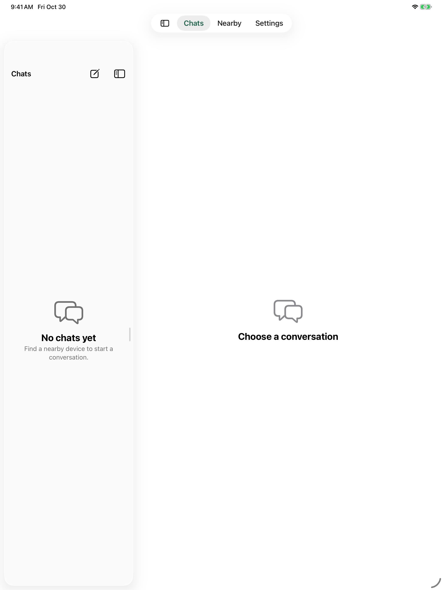
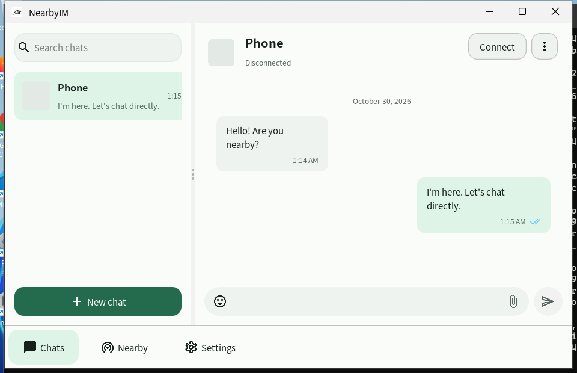
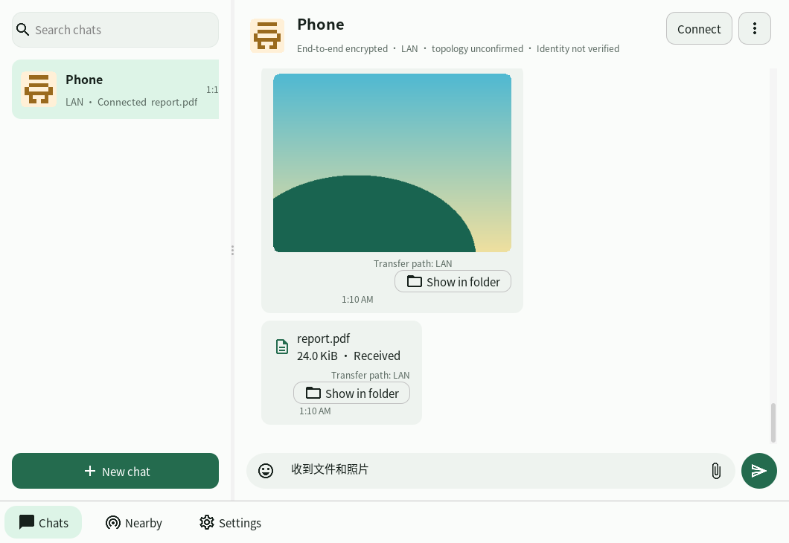
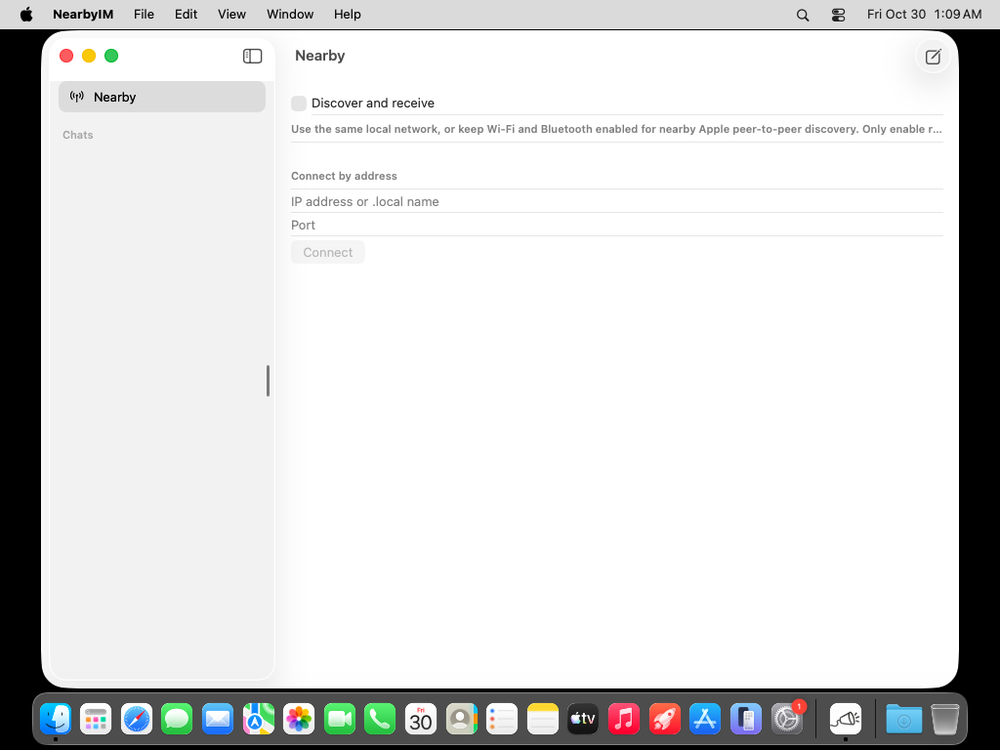
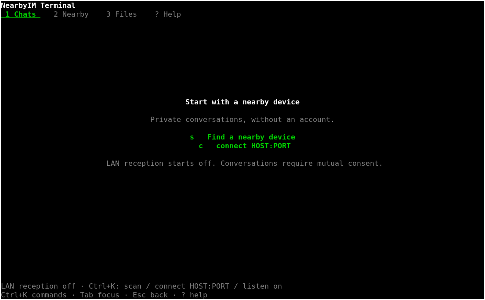
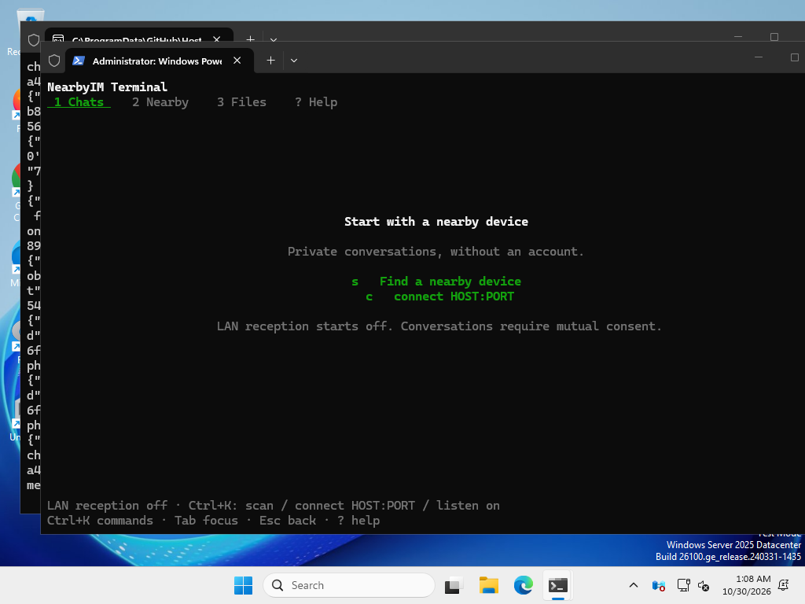

# 0.3.3-preview.4 / build15

本轮安装包与实际运行截图，已作为 **Release v0.3.3** 发行。包内版本仍为 preview.4/build15，未重新编译。手机仅竖屏。图中使用空白资料或隔离的示例会话，不包含用户聊天记录，也不代表真实无线/性能验收。

Packages and actual runtime screenshots published in **Release v0.3.3**, reusing preview.4/build15 binaries without recompilation. Phones use portrait. Empty profiles or isolated sample conversations contain no user data and do not establish physical wireless/performance acceptance.

## 下载 / Downloads

安装包可直接从 [Release v0.3.3](https://github.com/GHOST-AKU/wozai/releases/tag/v0.3.3) 下载，无需先解压 Actions 附件。文件名和软件内部仍保留 preview.4；原始签名、源码与哈希不变。历史 Actions 附件有登录及保留期限限制，仅用于来源追溯。Apple 的安装限制见[安装说明](../../releases/native-preview-install.md)。

Download directly from [Release v0.3.3](https://github.com/GHOST-AKU/wozai/releases/tag/v0.3.3). Original filenames, internal preview.4 identity, signatures, sources and hashes are unchanged. Historical Actions artifacts require login and expire; they document provenance. See [Apple installation/signing limitations](../../releases/native-preview-install.md).

| 平台 / Platform | 安装包 / Package | 下载 / Download |
| --- | --- | --- |
| Android | 原签名 release APK / persistent-signer release APK | [APK](https://github.com/GHOST-AKU/wozai/releases/download/v0.3.3/NearbyIM-0.3.3-preview.4-build15-android.apk) |
| Windows x64 GUI | 自带 Java 运行时的便携 ZIP / bundled-runtime portable ZIP | [ZIP](https://github.com/GHOST-AKU/wozai/releases/download/v0.3.3/NearbyIM-0.3.3-preview.4-windows-x64.zip) |
| Linux x64 GUI | AppImage / deb / tar.gz | [AppImage](https://github.com/GHOST-AKU/wozai/releases/download/v0.3.3/NearbyIM-0.3.3-preview.4-linux-x64.AppImage) / [deb](https://github.com/GHOST-AKU/wozai/releases/download/v0.3.3/NearbyIM-0.3.3-preview.4-linux-x64.deb) / [tar.gz](https://github.com/GHOST-AKU/wozai/releases/download/v0.3.3/NearbyIM-0.3.3-preview.4-linux-x64.tar.gz) |
| macOS Intel + Apple Silicon | 通用 ad-hoc ZIP，无公证 / universal ad-hoc ZIP, not notarized | [Mac ZIP](https://github.com/GHOST-AKU/wozai/releases/download/v0.3.3/NearbyIM-0.3.3-preview.4-macos-universal-adhoc.zip) |
| iOS / iPadOS | 未签名 IPA，需自行签名 / unsigned IPA, re-signing required | [IPA](https://github.com/GHOST-AKU/wozai/releases/download/v0.3.3/NearbyIM-0.3.3-preview.4-ios-ipados-unsigned.ipa) |
| Windows x64 Terminal | 独立便携 ZIP / standalone portable ZIP | [ZIP](https://github.com/GHOST-AKU/wozai/releases/download/v0.3.3/nearbyim-terminal-0.3.3-preview.4-windows-x64.zip) |
| Linux x64 Terminal | 独立 tar.gz / standalone tar.gz | [tar.gz](https://github.com/GHOST-AKU/wozai/releases/download/v0.3.3/nearbyim-terminal-0.3.3-preview.4-linux-x64.tar.gz) |

九个包文件的 [SHA-256](SHA256SUMS-packages.txt)。Android 证书 SHA-256：`47a10fd5a882ab26c9a11fcc61df3b41f7c41017746fc6840cfbe581ca52c1dd`。Windows 无 Authenticode 签名；Mac 无 Developer ID 签名或公证；IPA 不能直接安装。

[SHA-256 for all nine package files](SHA256SUMS-packages.txt). Windows has no Authenticode signature; Mac has no Developer ID/notarization; the IPA requires re-signing.

## 手机 / Phones

Android 为 API34 Pixel 7 模拟器安装原签名 release APK。iPhone 为同源 Release 模拟器应用，使用模拟器 ad-hoc 签名，不等于设备 IPA 的分发签名。

Android runs the signed release APK on an API34 Pixel 7 emulator. iPhone uses a source-identical simulator Release app with simulator ad-hoc signing, distinct from device-IPA distribution signing.

| Android | iPhone |
| --- | --- |
|  |  |

## iPad

iPad 模拟器，同源 Release 应用 / iPad simulator, source-identical Release app.

## 桌面 / Desktop

Windows：已打包运行时、隔离资料库中预置的本地示例消息；已读状态用于展示样式，不是本次真实设备互通证据。960×620 窗口适应 CI 显示器，没有修改应用默认窗口或分栏比例。

Windows uses the packaged runtime and isolated local sample history. The read state illustrates its style, not a new physical-device receipt exchange. The capture window is 960×620 to fit the CI display; application defaults and split ratios are unchanged.

Linux：已打包运行时与自动化会话夹具 / packaged runtime with an automated conversation fixture.

macOS：实际通用 Release 应用启动界面 / actual universal Release app startup screen.

## Terminal

实际成品二进制，无监听的独立资料库。Linux 为 Debian 13 / Xvfb + xterm，本次复用 Ubuntu22.04 构建的原二进制；Windows 为 CI 原生终端。字体和颜色由终端能力及用户设置决定。

Actual packaged executables, isolated profiles, listening disabled. Linux runs the unchanged Ubuntu22.04-built binary under Debian13 / Xvfb + xterm; Windows uses the native CI terminal. Fonts and colors depend on terminal capabilities and user settings.

## 来源与限制 / Provenance and limits

- Android / Apple / Terminal：`76d83380f80ce1428c6a99bdb0c8ec44cdac9aea`。
- Windows / Linux GUI：`8f9dd65c40abdbb8ed455e07d6b901e3e1bc02d7`；与76d8338的应用源、资源、版本和打包脚本相同，仅工作流路由不同 / identical product inputs; workflow routing differs.
- iPhone 补采 / screenshot recovery：run [40984676065](https://github.com/GHOST-AKU/wozai/actions/runs/40984676065)，控制提交 `c1fd0f93e234810e43e806b27fea2c0fd85231e6`；签名 Release 应用与 iPhone 图片已完成，但任务整体因后续采集长时间未完成而取消。只复用已人工检查的 iPhone 图，不把 cancelled 写成整体通过 / a valid signed Release iPhone capture was retained from the cancelled run; this is not a passing overall workflow.
- iPad 补采 / screenshot recovery：run [40986573835](https://github.com/GHOST-AKU/wozai/actions/runs/40986573835)，控制提交 `d3bb56ea8229fc8dbd7595e1bfb00525c6220852`，只采集缺失的 iPad 界面，设备 IPA 未重建 / only the missing iPad image is captured; device IPA is not rebuilt.
- [40986313102](https://github.com/GHOST-AKU/wozai/actions/runs/40986313102) 在 Xcode16.4/SDK18.5 编译失败（`AttachmentViews.swift:129` actor isolation）；当前成功的 Apple 分发包使用 Xcode26.6。该旧工具链失败未修复或隐去，详见 [#31 记录](https://github.com/GHOST-AKU/wozai/issues/31#issuecomment-6512750856) / the older-toolchain failure is retained, not claimed resolved.
- Windows 补采 / screenshot recovery：run [40984831185](https://github.com/GHOST-AKU/wozai/actions/runs/40984831185)，只下载原包、编译截图驱动并运行，未重建产品 / no product rebuild.
- 原 Linux Terminal 截图全黑、Linux 包启动首帧图为空、原 Windows 图像超出显示器、原 Apple 移动模拟器未签名导致钥匙串错误：保留采集失败证据，未作为效果图交付 / initial capture failures are retained as evidence and excluded from this gallery.
- 本轮仅版本、文档及构建/截图工具变化；不据打包成功重新宣称无线、点对点或性能验收 / packaging does not establish physical network or performance acceptance.
