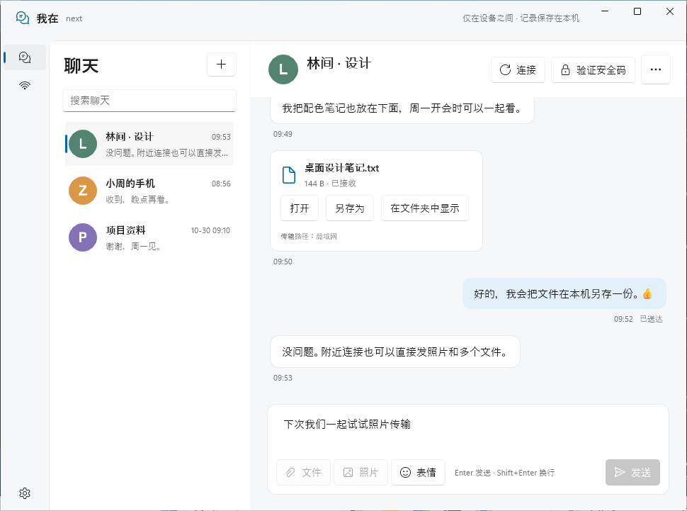
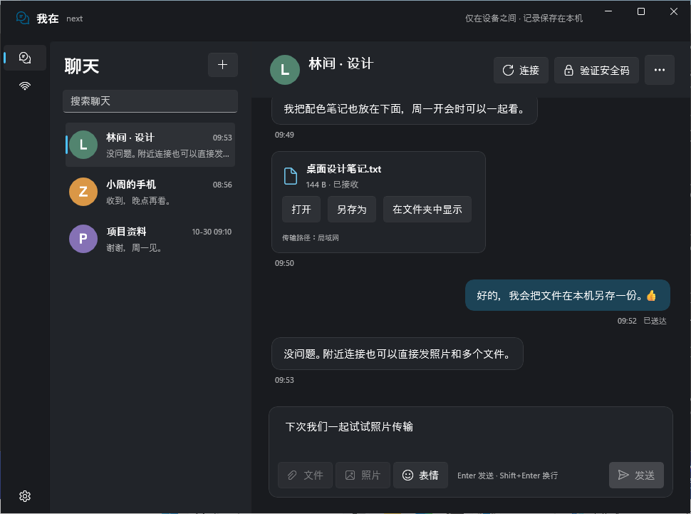
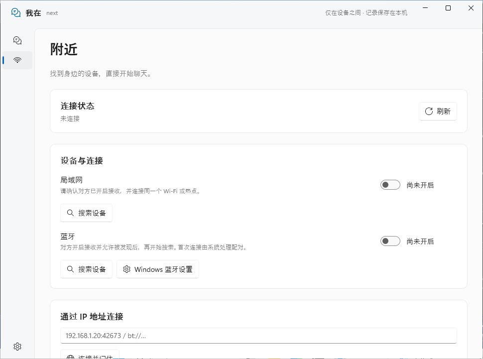
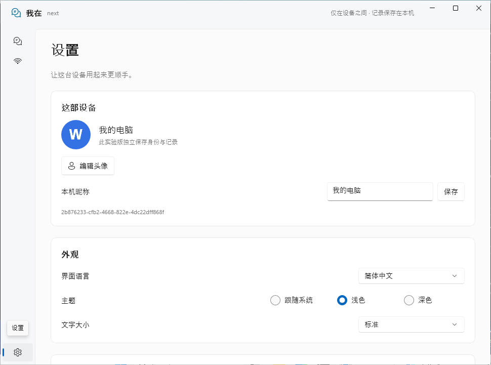

# 我在next · WinUI 3 实际运行截图

截图来自 [Windows 原生窗口验收工作流](https://github.com/GHOST-AKU/wozai/actions/runs/41191384984)，二进制源码为 `97a9cc39d377d9da4ddaf71c604a69b5093422a3`。通过 GDI 捕获 DWM 提供的窗口可见边界，保留原始 PNG；未使用网页、设计稿或生成图代替原生窗口。

会话、文件、头像和回执来自隔离的测试资料，不是真人记录或物理无线性能证据。窗口的真实双内核收发另有 UI Automation 验收。

| 浅色聊天 | 深色聊天 |
| --- | --- |
|  |  |

| 附近设备 | 设置 |
| --- | --- |
|  |  |

[下载 Windows x64 实验包](https://github.com/GHOST-AKU/wozai/actions/runs/41191384984/artifacts/13038469898)。下载后取其中的 `WoZai-next-0.3.3-preview.4-windows-x64.zip`，解压并运行 `WoZaiNext/WindowsNext.exe`。此实验包未做 Authenticode 签名。

便携 ZIP 的 SHA-256：

```text
c5835e54ff89ff77d9aea3ec9ef239a9add0fbb87a98b56e3c22099db9bfc1a2
```

每张 PNG 的 SHA-256 与验证范围见 [来源记录](manifest.json)；安装、功能及真实设备验收边界见 [客户端说明](../../windows-next.md)。
